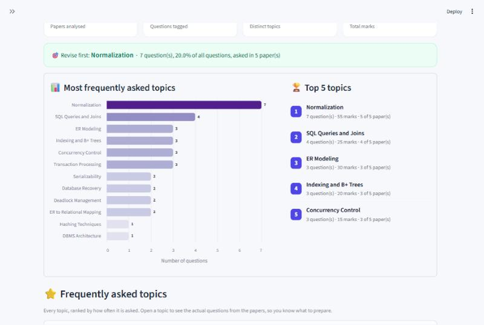
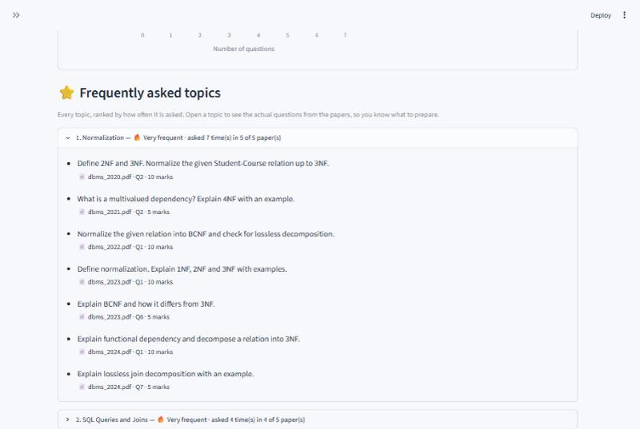
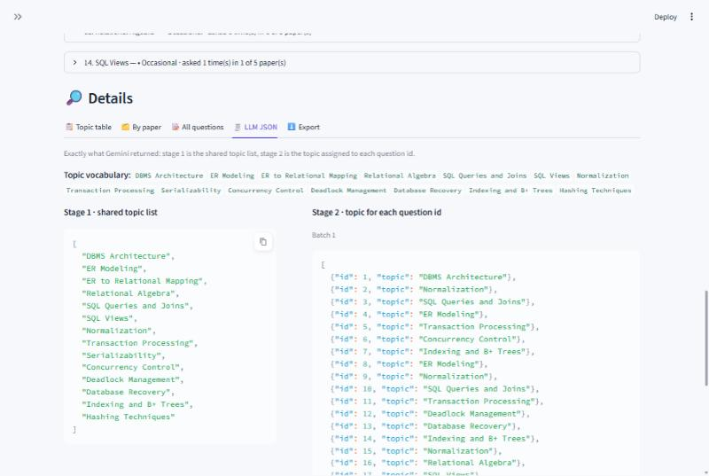

# Previous Year Question Paper Analyzer (PS37)

## Problem statement

Students want to know which topics are important. This app analyses uploaded previous-year question papers and lists the topics that are asked most often, so students know what to revise first.

**Required approach (PS37):** extract text from several papers → LLM tags each question with a topic as JSON → count with pandas → show a bar chart of top topics.

| Step | Where it happens |
|---|---|
| Extract text from several papers | `core/extract.py`: `pdfplumber` reads each PDF and splits it into numbered questions |
| LLM tags each question as JSON | `core/tagger.py`: Gemini (JSON output mode) first builds one shared topic list, then returns `[{"id": 1, "topic": "..."}]` for every question |
| Count with pandas | `core/analysis.py`: `groupby` counts questions, marks and papers per topic |
| Bar chart of top topics | `app.py`: Streamlit bar chart of the 12 most frequent topics |

## Tools and model

- Python 3.10+, Streamlit (UI), pdfplumber (PDF text), pandas (counting)
- LLM: Google Gemini Flash through the Gemini REST API. The default model is `gemini-3.8-flash`, with `gemini-3.6-flash` and `gemini-3.5-flash` as fallbacks. You can change the model in the sidebar.

## How to run

```powershell
py -m venv .venv
.venv\Scripts\Activate.ps1
pip install -r requirements.txt
streamlit run app.py
```

Then:

1. Get a free API key from [Google AI Studio](https://aistudio.google.com/app/apikey).
2. Paste the key into the sidebar, keep **Remember on this computer** ticked, and click **Save key**. You only do this once: the key is saved to a local `.env` file, which is gitignored, and loaded automatically next time. After that the key section disappears from the sidebar so the key is never on screen. To replace it, use **Advanced settings → Replace API key**.
3. Upload one or more PDFs, or choose **Use the 5 sample papers**.
4. Click **Analyse papers**.

## What the app shows

- Summary numbers: papers analysed, questions tagged, distinct topics, total marks
- A bar chart of the most frequently asked topics, with a top-5 list beside it
- **Frequently asked topics:** every topic ranked and labelled 🔥 Very frequent, ⭐ Frequent or • Occasional, based on how many papers ask it. Opening a topic shows the actual questions asked on it, with paper, question number and marks
- A frequency table with question count, % share, total marks and number of papers covering each topic
- A topic × paper table, a per-paper summary and every tagged question
- The raw JSON returned by the LLM
- Downloads: topic counts (CSV), tagged questions (CSV and JSON)

## Sample inputs

`samples/` holds five DBMS papers (2020–2024). Each has 7 questions numbered in a different style (`1.`, `Q1.`, `Q.1`, `1)`, `Question 1:`) to exercise the question splitter.

## Screenshots

Results for the five sample papers:







## Limitations

- PDFs need selectable text. Scanned papers must be OCR'd first.
- Question splitting is heuristic. Check the **All tagged questions** table for mistakes.
- LLM topic labels can be imperfect. `Unclassified` means the model skipped a question or used a label outside the approved list.
- If Gemini is overloaded (HTTP 503), the app retries and falls back to other models. If all of them are busy, try again a few minutes later.

## Project layout

```text
app.py              Streamlit interface and workflow
core/extract.py     PDF text extraction and question splitting
core/tagger.py      Gemini prompts, JSON parsing and topic tagging
core/llm_client.py  Gemini REST client, retries and API-key lookup
core/analysis.py    pandas summaries and chart data
samples/            Five sample DBMS question papers
screenshots/        Screenshots of the app's results
```
